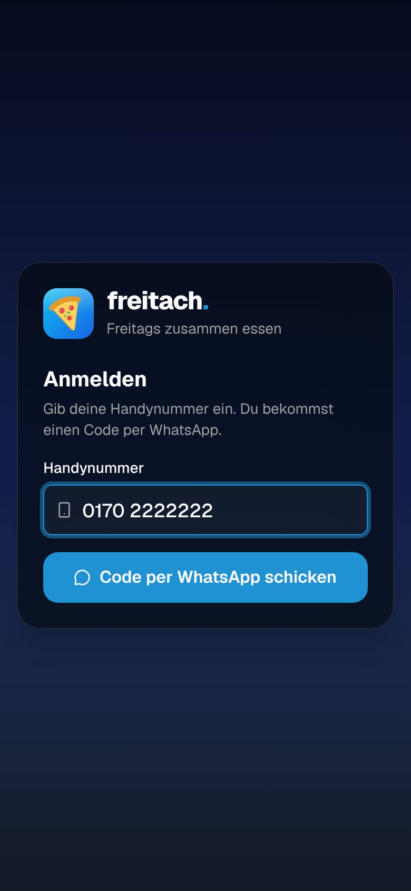
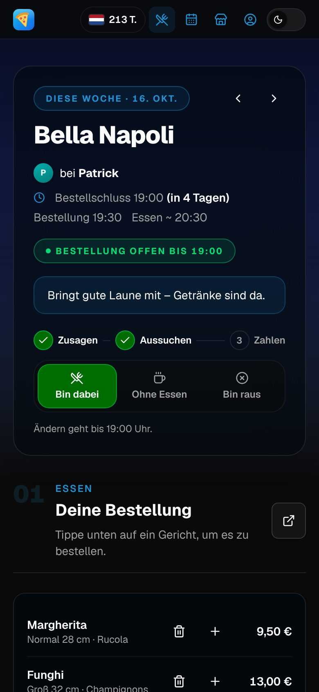
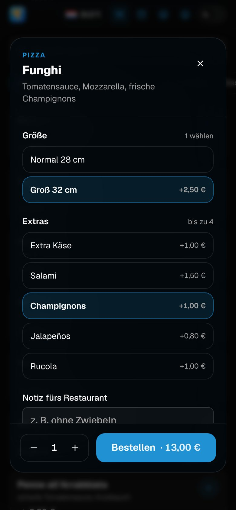
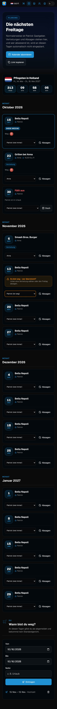

# futtarns

Friday food ordering for our group, running at [freitach.arns.dev](https://freitach.arns.dev).

Every Friday someone hosts, everyone else says whether they come, picks a dish from the
restaurant of the week (or pays the flat price of a barbecue), pays up front via PayPal,
and the host places one order on Lieferando. A WhatsApp bot does the chasing.

## What it does

- **Login by phone number**: enter your number, get a six-digit code on WhatsApp. Personal
  login links remain as a fallback.
- **Friday page**: answer (in / comes but doesn't eat / out), pick dishes with sizes and
  extras, order for guests, see who eats what and what it costs.
- **Default dish per restaurant**: whoever says nothing counts as in and gets their default
  when ordering closes at 19:00 (Bestellschluss). A default of „nix“ means coming without
  eating. The order goes out at 19:30, food arrives around 20:30.
- **Money**: own dishes plus an equal share of delivery, Lieferando's 0,99 € fee and the tip
  (2,50 € unless the host changes it). A drinks fee of 1,50 € per person who comes, on by
  default and switched off with one tap. Pay up front with a PayPal.me link that has the
  amount filled in. After the order the host enters the real total and the split is
  corrected; reminders follow until everyone has paid. The host pays nothing to themselves.
- **Flat-price Fridays** such as a barbecue: one price per person, no menu.
- **Calendar**: who hosts (substitutes per Friday), cancelled Fridays, everyone's absences,
  and an iCal feed for the phone calendar. A host who enters an absence is told which
  Fridays need a substitute, and those Fridays ask „wer übernimmt?“.
- **Restaurants**: fees, minimum order, menus from Lieferando (bookmarklet or copy and paste,
  with a preview); anyone can add a missing dish. Every host has their own usual restaurant.
- **Pentecost countdown**: days until the Friday we leave for Holland, on every page.
- **WhatsApp bot**: the invitation and order reminder on Friday at 10:00, the order list for
  the host and everyone's payment link at 19:00, the settled amounts and daily payment
  reminders. People can
  answer with `1`, `2`, `3`, `wie immer`, `andere`, `bezahlt`, `status` or `code`.

## Screenshots

| Login                                    | Friday                                   | Dish                                        | Calendar                                     |
| ---------------------------------------- | ---------------------------------------- | ------------------------------------------- | -------------------------------------------- |
|  |  |  |  |

More in [docs/screenshots](docs/screenshots): paying, the barbecue, restaurants, profile, the
host's tools, people, light mode and desktop.

## Development

Node 24 and pnpm 12 (`corepack enable` picks the version from `package.json`).

```bash
pnpm install
pnpm seed        # demo group, restaurants and Fridays in an embedded database (.data/)
pnpm dev         # http://localhost:3000/login – the code is shown on the page without a bot
```

Without `DATABASE_URL` the app uses an embedded PGlite database, and without `BOT_URL` every
WhatsApp message is printed to the console instead of being sent.

| Command                                                            |                                                                    |
| ------------------------------------------------------------------ | ------------------------------------------------------------------ |
| `pnpm test`                                                        | unit and database tests (Vitest, in-memory PGlite)                 |
| `pnpm lint` / `pnpm typecheck` / `pnpm format:check`               | the checks CI runs                                                 |
| `pnpm db:generate --name <change>`                                 | a new migration after editing `lib/db/schema.ts`                   |
| `pnpm member:create --name … --phone … [--admin] [--default-host]` | add someone from the shell                                         |
| `node scripts/screenshots.mjs [dir]`                               | screenshots of the main screens (needs `pnpm seed` and `pnpm dev`) |

## Docs

- [Architecture](docs/architecture.md): data model, the Friday lifecycle, money, reminders.
- [Deployment](docs/deployment.md): Docker Compose on Coolify, DNS, linking WhatsApp.
- [Design](docs/design.md): how the park.fan look is reproduced.
